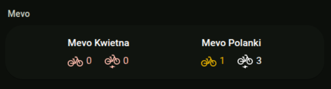
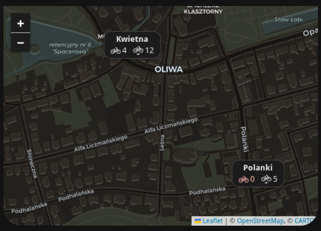

# Mevo sensors for Home Assistant

Integrate the Tricity Mevo bike API with Home Assistant to monitor bike counts
at stations. This integration can be installed using the Home Assistant Marketplace
or [HACS](https://hacs.xyz/).

[](https://my.home-assistant.io/redirect/hacs_repository/?owner=dulek&repository=ha-mevo&category=integration)

## Features

- Sensor entities for selected Mevo stations
- Updates every 5 minutes for available bikes, e-bikes, and docks
- Station details: address, location, capacity, rental URI
- A dashboard card for station lists and maps

## Installation

1. Open the repository using the badge above. If it is not in the catalog yet,
   add it as a custom integration when prompted.
2. Install **Mevo** in the Marketplace or HACS.
3. Restart Home Assistant if prompted.

## Configuration

Mevo is configured from the Home Assistant UI. Go to **Settings → Devices &
Services → Add Integration** and search for **Mevo**. The integration will
fetch the live station list from the Mevo API and let you pick the stations
you want to monitor from a dropdown.

To change the set of monitored stations later, open the integration entry
and click **Configure**.

## Dashboard card

Mevo includes a card that shows bike and e-bike counts in a list or on a map.
It is registered automatically when dashboard resources use storage mode.
Refresh your browser after installing or updating the integration, then search
for **Mevo Card** in the dashboard editor. Dashboard YAML can use:

```yaml
type: custom:mevo-card
title: Mevo Stations
stations:
  - sensor.station_gda001
  - entity: sensor.station_gda002
    name: Plac Solidarności
```

Add `view: map` for the map view. Each station needs `latitude` and `longitude`
attributes, which this integration provides. The card also accepts any sensor
with `bikes_available` and `ebikes_available` attributes.




### Card options

| Option | Default | Description |
| --- | --- | --- |
| `title` | None | Header shown above the card. |
| `view` | `list` | `list` or `map`. |
| `stations` | Required | Entity IDs, or objects with `entity` and optional `name`. |
| `extra` | None | `docks` and/or `capacity` indicators in list view. |
| `home` | None | Zone, person, or device tracker entity shown on the map. |
| `zoom` | Auto | Fixed map zoom level. |

### YAML-managed dashboard resources

If you manage dashboard resources in YAML, add this module resource yourself:

```yaml
lovelace:
  resources:
    - url: /mevo/mevo-card.js?v=0.9.3
      type: module
```

Update the `v=` value when you install a newer Mevo release so browsers load
the new card code.

### Migrating from the separate Mevo Card repository

If you installed `ha-mevo-card` separately, remove that card from the Marketplace
or HACS before updating Mevo. Remove any manually configured resource pointing
to `/local/mevo-card/card.js` or `/hacsfiles/ha-mevo-card/card.js`. Then restart
Home Assistant. Your dashboard cards can keep their `type: custom:mevo-card`
configuration. The integration skips automatic registration while it detects
the old resource, to avoid loading two versions of the same card.

## Sensor Attributes

Each sensor provides:

- `state`: Number of bikes available (both types)
- `docks_available`: Number of docks available (free spaces, not really useful anymore)
- `bikes_available`: Number of regular bikes available
- `ebikes_available`: Number of electric bikes available
- `station_id`: Station ID
- `address`: Station address
- `latitude` / `longitude`: Station location
- `capacity`: Station capacity
- `rental_uri`: URI for bike rental

## Support

For issues or feature requests, open an issue on GitHub.
